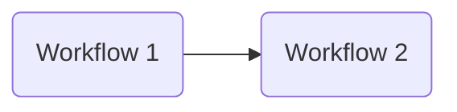
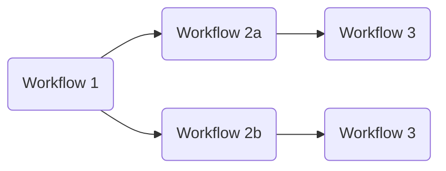
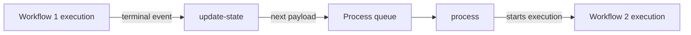

# Chaining workflows

Workflow chaining lets multiple workflow executions run in sequence, with
the output of one becoming the input of the next. Chaining is implemented
as an extension to the Cirrus Payload format: the `process` key holds an
array of process definitions, where each element represents a link in the
chain. A payload chaining two workflows looks like:

```json
{
    "process": [
        { "workflow": "workflow-1" },
        { "workflow": "workflow-2" }
    ]
}
```

This models a simple chain:



Each element of `process` after the first can also be a nested array, to
model branching within the chain. For example:

```json
{
    "process": [
        { "workflow": "workflow-1" },
        [
            { "workflow": "workflow-2a" },
            { "workflow": "workflow-2b" }
        ],
        { "workflow": "workflow-3" }
    ]
}
```

produces an execution chain that looks like this:



Chaining alone can model one-to-one and one-to-many dependency
relationships; it has no facility for merging branches back together.

## How chaining runs

When a workflow's Step Functions execution succeeds, the `update-state`
Lambda function (triggered by the execution's terminal EventBridge event)
builds the next payload(s) for the chain and, if `CIRRUS_PROCESS_QUEUE_URL`
is configured, enqueues each one onto the process SQS queue. Each queued
payload is then picked up by the `process` Lambda function like any other
incoming payload, which starts the next workflow's execution:



Building the next payload(s) (`next_payloads` on the succeeded execution's
output) works as follows:

- The first element of `process` (the definition for the workflow that just
  finished) is dropped from the array.
- If there is no further element in `process`, the chain ends and nothing is
  enqueued.
- If the next element is a single process definition (a dict), one payload
  is produced with that definition as the new `process[0]`. If it's a list
  (a branch), one payload is produced per element in the list.
- Each produced payload has its `id` removed, since a new one will be
  derived (or assigned) for the next workflow's execution — the same
  payload `id` cannot be reused for a different workflow.

Chaining only fires for successful executions; a `FAILED`, `ABORTED`, or
`TIMED_OUT` execution does not enqueue any next payload.

## Filtering output items

When a successive workflow in a chain doesn't need every item produced by
the preceding workflow, chaining supports filtering the output items via a
[JSONPath](https://goessner.net/articles/JsonPath/index.html) filter
expression. Set the filter in the successive workflow's process definition
using the `chain_filter` key (see the
[process definition reference](../reference/payload-schema.md#process-definition)).
For example, to keep only items with an `id` starting with `SWE` and a
`confidence` property greater than 80:

```json
{
    "process": [
        { "workflow": "workflow-1" },
        {
            "workflow": "workflow-2",
            "chain_filter": "@.id =~ 'SWE.*' & @.properties.confidence > 80"
        }
    ]
}
```

The `chain_filter` value is a JSONPath filter expression applied to the
preceding workflow's output `features`. It's substituted into the
expression:

```
$.features[?(<chain_filter>)]
```

So the example above evaluates:

```
$.features[?(@.id =~ 'SWE.*' & @.properties.confidence > 80)]
```

and only the matching items are carried into the next payload's `features`.
