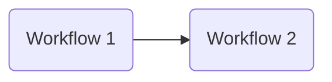
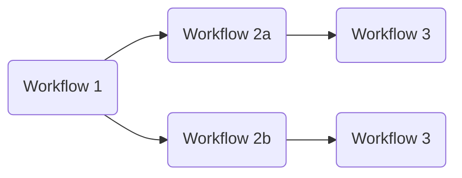
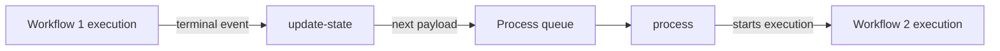

# Chaining workflows

Chaining runs workflow executions in sequence, with the output payload of one becoming the input payload of the next. It is expressed in the payload itself: the `process` array holds one process definition per link, and each execution consumes the first entry. A payload chaining two workflows:

```json
{
    "process": [
        { "workflow": "workflow-1" },
        { "workflow": "workflow-2" }
    ]
}
```



An entry after the first can itself be an array, which fans out: one execution per element, each continuing independently with the rest of the chain.

```json
{
    "process": [
        { "workflow": "workflow-1" },
        [
            { "workflow": "workflow-2a" },
            { "workflow": "workflow-2b" }
        ],
        { "workflow": "workflow-3" }
    ]
}
```



Chaining expresses one-to-one and one-to-many dependencies. It has no way to merge branches back together, and a branch element cannot itself contain a nested array.

## How chaining runs

When an execution reaches `SUCCEEDED`, the [`update-state`](../reference/lambda-functions.md#update-state) function calls `PayloadManager.next_payloads` on the execution's output payload and, when `CIRRUS_PROCESS_QUEUE_URL` is set, sends each result to the process queue. From there it is an ordinary incoming payload: `process` picks it up and starts the next execution.



`next_payloads` (`cirrus.lib.payload_manager`) builds each next payload from a deep copy of the output payload:

- The first `process` entry, the definition just run, is removed.
- If nothing remains, the chain ends and nothing is enqueued.
- If the next entry is a single definition, one payload is produced with it as `process[0]`. If it is an array, one payload is produced per element.
- The `id` is deleted. `process` generates a new one from the output items and the next workflow name, so a chained execution never reuses the previous execution's ID.
- If the next definition has a `chain_filter`, `features` is reduced to the items that match it.

Only `SUCCEEDED` executions chain. A `FAILED`, `INVALID`, `ABORTED`, or timed-out execution enqueues nothing, and a succeeded execution with no output payload enqueues nothing either.

## Filtering output items

When the next workflow needs only some of the preceding workflow's output items, set `chain_filter` on its process definition to a [JSONPath](https://goessner.net/articles/JsonPath/index.html) filter expression. To keep only items whose `id` starts with `SWE` and whose `confidence` property exceeds 80:

```json
{
    "process": [
        { "workflow": "workflow-1" },
        {
            "workflow": "workflow-2",
            "chain_filter": "@.id =~ 'SWE.*' & @.properties.confidence > 80"
        }
    ]
}
```

The expression is substituted into `$.features[?(<chain_filter>)]` and evaluated with `jsonpath-ng` against the output payload, so the example evaluates:

```text
$.features[?(@.id =~ 'SWE.*' & @.properties.confidence > 80)]
```

Only the matching items are carried into the next payload's `features`. A filter that matches nothing produces a payload with an empty `features` array, which `process` rejects because it cannot generate an `id` without items.
