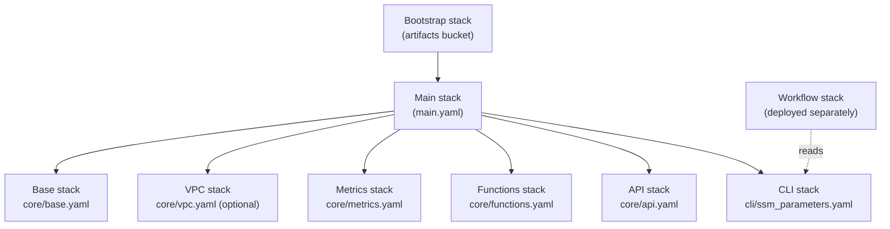

# Quickstart

This walks through deploying Cirrus infrastructure to AWS (or LocalStack) using
the CloudFormation templates in [`cloudformation/`](https://github.com/cirrus-geo/cirrus-geo/tree/main/cloudformation),
then running a minimal test workflow through it with the Cirrus CLI.

## Overview

The CloudFormation templates deploy Cirrus as a set of nested stacks:

- **Base infrastructure** (`core/base.yaml`): S3 data and payload buckets, the
  DynamoDB state table, SQS process/dead-letter queues, SNS publish and
  workflow-event topics.
- **VPC** (`core/vpc.yaml`, optional): VPC with public/private subnets, NAT
  gateway, and S3/DynamoDB gateway endpoints for Lambda networking.
- **Workflow metrics** (`core/metrics.yaml`): a CloudWatch log group and
  metric filters for workflow events.
- **Lambda functions** (`core/functions.yaml`): the five core functions (API,
  Process, Update State, Pre-Batch, Post-Batch) with their IAM roles.
- **API Gateway** (`core/api.yaml`): a REST API (EDGE) proxying to the API
  Lambda, with CloudWatch access logging.
- **CLI configuration** (`cli/ssm_parameters.yaml`): Parameter Store entries
  the Cirrus CLI reads to discover a deployment's resources.

A separate **bootstrap** stack (`bootstrap/bootstrap.yaml`) creates the S3
bucket used to stage packaged Lambda code and templates before the main stack
deploys. Workflows (Step Functions state machines) deploy as their own
stacks, independent of the main stack, so they can iterate without touching
core infrastructure.



## Prerequisites

- AWS CLI installed and configured, with credentials that have permission to
  create the resources above (`CAPABILITY_NAMED_IAM` is required for the main
  stack deploy).
- Python 3.12+ for Lambda function packaging.
- The Cirrus CLI installed — see [Installing](../cli/01_install.md).
- For the LocalStack path: Docker, to run LocalStack via `compose.yml`.

## Configure deployment variables

Stack names and deployment parameters are set as shell environment variables,
sourced from a `.env.aws` (or `.env.localstack`) file at the project root:

```bash
cp .env.aws.example .env.aws
# edit .env.aws as needed
source .env.aws
```

`.env.aws.example` sets:

| Variable | Default | Purpose |
| --- | --- | --- |
| `BOOTSTRAP_STACK` | `cirrus-bootstrap` | Bootstrap stack name |
| `MAIN_STACK` | `cirrus-sandbox` | Main stack name |
| `MINIMAL_WORKFLOW_STACK` | `cirrus-sandbox-minimal-workflow` | Minimal workflow stack name |
| `RESOURCE_PREFIX` | `cirrus-sandbox` | Prefix applied to all resource names (`ResourcePrefix` parameter) |
| `LAMBDA_PYTHON_VERSION` | `3.13` | Lambda runtime version |
| `LAMBDA_ARCH` | `arm64` | Lambda CPU architecture |
| `LOG_LEVEL` | `DEBUG` | Cirrus log level |
| `ENABLE_VPC` | `true` | Whether to create a VPC and attach Lambdas to it |
| `VPC_CIDR` | `10.1.0.0/16` | VPC CIDR block |
| `PRIVATE_SUBNET_CIDR` | `10.1.10.0/24` | Private subnet CIDR |
| `PUBLIC_SUBNET_CIDR` | `10.1.1.0/24` | Public subnet CIDR |

## Bootstrap and deploy (AWS)

### 1. Deploy the bootstrap stack

Creates the S3 bucket used to stage packaged Lambda code and templates:

```bash
aws cloudformation deploy \
  --stack-name "$BOOTSTRAP_STACK" \
  --template-file cloudformation/bootstrap/bootstrap.yaml \
  --parameter-overrides \
    "ResourcePrefix=$RESOURCE_PREFIX"
```

!!! note
    `aws cloudformation deploy` is a create-or-update operation: it modifies
    an existing stack if one exists, for this and every deploy command below.

### 2. Package the Lambda functions

```bash
./bin/build-lambda-dist.py \
    -p "$LAMBDA_PYTHON_VERSION" \
    -a "$LAMBDA_ARCH" \
    -o "cloudformation/core/lambda-packages/cirrus-lambda-dist.zip"
```

### 3. Package and deploy the main stack

```bash
# Get the S3 bucket for packaging
ARTIFACT_BUCKET=$(aws cloudformation describe-stacks \
  --stack-name "$BOOTSTRAP_STACK" \
  --query 'Stacks[0].Outputs[?OutputKey==`CirrusDeploymentArtifactsBucket`].OutputValue' \
  --output text)

# Package templates and Lambda code
aws cloudformation package \
  --template-file cloudformation/main.yaml \
  --s3-bucket "$ARTIFACT_BUCKET" \
  --output-template-file packaged-template.yaml

# Deploy the packaged stack
aws cloudformation deploy \
  --stack-name "$MAIN_STACK" \
  --template-file packaged-template.yaml \
  --parameter-overrides \
    "ResourcePrefix=$RESOURCE_PREFIX" \
    "LambdaPythonVersion=$LAMBDA_PYTHON_VERSION" \
    "LambdaArch=$LAMBDA_ARCH" \
    "LogLevel=$LOG_LEVEL" \
    "EnableVpc=$ENABLE_VPC" \
    "VpcCidr=$VPC_CIDR" \
    "PrivateSubnetCidr=$PRIVATE_SUBNET_CIDR" \
    "PublicSubnetCidr=$PUBLIC_SUBNET_CIDR" \
  --capabilities CAPABILITY_NAMED_IAM
```

### 4. Inspect deployed resources

```bash
aws cloudformation describe-stacks --stack-name "$MAIN_STACK" \
  --query 'Stacks[0].Outputs | sort_by(@, &Description)' \
  --output table
```

The main stack's outputs include the data and payload bucket names, the state
table name, the process queue URL, SNS topic ARNs, the API Gateway URL and ID,
and the CLI's deployment name and Parameter Store prefix (see `main.yaml` for
the full output list).

## Run the minimal test workflow

Workflows deploy as separate stacks so they can be iterated on without
touching core infrastructure. A minimal workflow is provided under
`cloudformation/workflows/minimal/` for testing a deployment end-to-end.

### Deploy the workflow stack

```bash
aws cloudformation deploy \
  --template-file cloudformation/workflows/minimal/state_machine.yaml \
  --stack-name "$MINIMAL_WORKFLOW_STACK" \
  --parameter-overrides \
    "ResourcePrefix=$RESOURCE_PREFIX" \
  --capabilities CAPABILITY_NAMED_IAM
```

The minimal workflow is a single Step Functions `Choice` state that checks
the `succeed` field in the first entry of the payload's `process` block: if
`true`, the execution succeeds; otherwise it fails with a
`WorkflowMismatch` error.

### Submit a test payload

`cloudformation/workflows/minimal/payload.json.template` is a payload
template with `succeed`, `replace`, and `id_suffix` template variables. Render
it with `cirrus payload template` and pass it to `cirrus manage run-workflow`,
which submits the payload, polls the state database until the execution
reaches a terminal state, and prints the output payload:

```bash
<cloudformation/workflows/minimal/payload.json.template cirrus payload template \
    | cirrus manage "$RESOURCE_PREFIX" run-workflow
```

Set `succeed` to `false` to drive a failing execution:

```bash
<cloudformation/workflows/minimal/payload.json.template cirrus payload template \
    -x succeed false \
    | cirrus manage "$RESOURCE_PREFIX" run-workflow
```

`run-workflow` exits `0` on a `SUCCEEDED` execution, `10` on any other
terminal state, and `11` if it times out waiting.

Set `replace` to `true` to allow resubmitting the same payload ID (default is
`false`), and set `id_suffix` to a unique value (default unset) to generate a
distinct payload ID per submission:

```bash
<cloudformation/workflows/minimal/payload.json.template cirrus payload template \
    -x succeed false \
    -x replace true \
    -x id_suffix "-$(uuidgen)" \
    | cirrus manage "$RESOURCE_PREFIX" run-workflow
```

## Stack cleanup (AWS)

S3 buckets must be emptied before their stacks can be deleted:

```bash
DATA_BUCKET=$(aws cloudformation describe-stacks \
  --stack-name "$MAIN_STACK" \
  --query 'Stacks[0].Outputs[?OutputKey==`CirrusDataBucket`].OutputValue' \
  --output text)

PAYLOAD_BUCKET=$(aws cloudformation describe-stacks \
  --stack-name "$MAIN_STACK" \
  --query 'Stacks[0].Outputs[?OutputKey==`CirrusPayloadBucket`].OutputValue' \
  --output text)

ARTIFACT_BUCKET=$(aws cloudformation describe-stacks \
  --stack-name "$BOOTSTRAP_STACK" \
  --query 'Stacks[0].Outputs[?OutputKey==`CirrusDeploymentArtifactsBucket`].OutputValue' \
  --output text)

aws s3 rm s3://$DATA_BUCKET --recursive
aws s3 rm s3://$PAYLOAD_BUCKET --recursive
aws s3 rm s3://$ARTIFACT_BUCKET --recursive
```

Then delete the stacks, workflows first, then the main stack, then bootstrap:

```bash
aws cloudformation delete-stack --stack-name "$MINIMAL_WORKFLOW_STACK"
aws cloudformation wait stack-delete-complete --stack-name "$MINIMAL_WORKFLOW_STACK"

aws cloudformation delete-stack --stack-name "$MAIN_STACK"
aws cloudformation wait stack-delete-complete --stack-name "$MAIN_STACK"

aws cloudformation delete-stack --stack-name "$BOOTSTRAP_STACK"
aws cloudformation wait stack-delete-complete --stack-name "$BOOTSTRAP_STACK"
```

## LocalStack

`bin/localstack-provision.bash` scripts packaging and deployment of the
bootstrap, main, and minimal workflow stacks against a local
[LocalStack](https://www.localstack.cloud/) instance, for development without
an AWS account:

```bash
./bin/localstack-provision.bash [bootstrap|debootstrap|deploy|delete]
```

### Prerequisites

- AWS CLI installed and configured.
- Python 3.12+ for Lambda function packaging.
- Docker, to run LocalStack via `compose.yml`.

### Deploy

```bash
cp .env.localstack.example .env.localstack
# edit .env.localstack as needed
source .env.localstack

docker compose up -d -V

./bin/localstack-provision.bash bootstrap
./bin/localstack-provision.bash deploy
```

`deploy` packages the Lambda functions, packages and deploys the main stack
(with `EnableVpc=false`), and deploys the minimal workflow stack. It can be
run repeatedly as an idempotent way to apply stack updates.

!!! note
    LocalStack can get into a broken state after a bad CloudFormation
    apply/rollback. If `deploy` leaves the system unrecoverable, restart
    LocalStack with `docker compose up -d -V` and redeploy from the bootstrap
    step.

### Interact with LocalStack-deployed infrastructure

Standard AWS CLI commands work against the LocalStack endpoint, for example
to list S3 buckets:

```bash
aws s3 ls
```

To call the API Gateway endpoint, get the API ID first:

```bash
API_ID=$(aws cloudformation describe-stacks \
  --stack-name "$MAIN_STACK" \
  --query 'Stacks[0].Outputs[?OutputKey==`ApiGatewayId`].OutputValue' \
  --output text)
```

then:

```bash
curl "http://localhost:4566/restapis/${API_ID}/dev/_user_request_/<desired_path>"
```

For example, to list items in the state database for the minimal workflow:

```bash
curl "http://localhost:4566/restapis/${API_ID}/dev/_user_request_/collection/workflow-minimal/items"
```

### Stack cleanup (LocalStack)

```bash
./bin/localstack-provision.bash delete
./bin/localstack-provision.bash debootstrap
```

## Next steps

- [Concepts & architecture](20_arch.md) for how these pieces fit together.
- [Payloads](30_payload.md) for the payload format the CLI and workflows
  consume.
- [CLI reference](../cli/00_intro.md) for the rest of the `cirrus` command
  tree.
