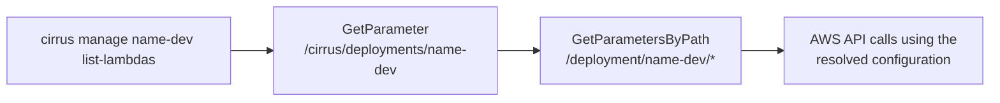

# Using the CLI

The Cirrus CLI, the `cirrus` command, operates an existing deployment. It submits and reruns payloads, inspects executions, queries the state database, fetches stored payloads and logs, and invokes the framework's Lambda functions directly. It is part of the `cirrus-geo` package, built with [click](https://click.palletsprojects.com/), and its code lives under `cirrus.management`.

This page covers installation, credentials, and how the CLI finds a deployment. Worked examples are in [Common workflows](common-workflows.md), and every command's options are in the [Command reference](reference.md). Deploying Cirrus itself is the [Quickstart](../getting-started/quickstart.md).

## Installing

```bash
pipx install 'cirrus-geo[cli]'
```

The `cli` extra adds the CLI's own dependencies, `click`, `click-option-group`, and `backoff`, on top of the package. To run one command without installing:

```bash
uvx --from 'cirrus-geo[cli]' cirrus version
```

## Credentials

The CLI calls AWS through `boto3`, so any credential source `boto3` resolves works: a named profile, environment variables, an instance role. The `--profile` and `--region` options, given before the subcommand, select a profile and region for the session:

```bash
cirrus --profile prod --region us-west-2 list-deployments
```

With IAM Identity Center, configure a profile once with `aws configure sso` and start each session with `aws sso login --profile <name>`. When the session has expired, the CLI reports it and exits rather than retrying.

### Required permissions

The identity needs permission for the AWS calls behind the commands it runs:

- `ssm:GetParameter` on `/cirrus/deployments/<name>` and `ssm:GetParametersByPath` on `/deployment/<name>/` for deployment discovery, and on `/cirrus/deployments/` for `list-deployments`.
- `lambda:ListFunctions` and `lambda:InvokeFunction` for `list-lambdas` and `invoke-lambda`.
- `sqs:SendMessage` on the process queue for `process` and `run-workflow`.
- `s3:GetObject` on the payload bucket to fetch payloads, and `s3:PutObject` to enqueue a payload larger than an SQS message.
- `dynamodb:GetItem`, `BatchGetItem`, and `Query` on the state table and its indexes, plus `Scan` and `UpdateItem` for `migrate`.
- `states:DescribeExecution`, `GetExecutionHistory`, and `DescribeStateMachine` for the `get-execution*` and `get-workflow-definition` commands.
- `logs:FilterLogEvents` and `logs:GetLogEvents` for `get-lambda-logs` and `get-batch-logs`.

Scope the grant to the commands the identity uses.

### Assuming a role

A deployment can name a role for the CLI to assume, either as a `CIRRUS_CLI_IAM_ARN` entry in its Parameter Store configuration or as `cirrus manage <deployment> --iam-arn <role-arn>` on the command line. The CLI calls `sts:AssumeRole` on that ARN with the current credentials and uses the temporary credentials, under the session name `cirrus_cli_session`, for every call against that deployment. The caller then needs only `sts:AssumeRole` on the role, and the permissions above live on the role. When both are present, the Parameter Store value wins and `--iam-arn` is ignored. No template creates the parameter; add it by hand when wanted.

## Deployment discovery

Commands under `manage` take a deployment name and look up that deployment's resources in Parameter Store at run time. The pointer parameter `/cirrus/deployments/<name>` holds a JSON value naming where the configuration lives, by default the path `/deployment/<name>/`. Under that path is one parameter per configuration value. The CLI requires `CIRRUS_PAYLOAD_BUCKET`, `CIRRUS_STATE_DB`, `CIRRUS_PROCESS_QUEUE_URL`, `CIRRUS_BASE_WORKFLOW_ARN`, and `CIRRUS_PREFIX`, and fails with a message naming any that are missing. The others the templates publish are listed under [Environment variables](../operating/deployment.md#environment-variables).



`cirrus list-deployments` prints every name under `/cirrus/deployments/` visible to the current credentials. `cirrus manage <deployment> show` prints the resolved configuration.

`cloudformation/cli/ssm_parameters.yaml` creates the pointer and configuration parameters as part of the main stack, with the deployment name equal to `ResourcePrefix`. A deployment built with other tooling needs to create the same parameters for the CLI to find it.

## Command structure

Deployment-scoped commands are `cirrus manage <deployment> <command>`. `mgmt` is an alias for `manage`, and every command group resolves any unambiguous prefix of a command name, so these are equivalent:

```bash
cirrus manage name-dev list-lambdas
cirrus mgmt name-dev list-lambdas
cirrus mgmt name-dev list-l
```

Commands that take a payload read it from standard input. Commands that return JSON pretty-print it by default and accept `--raw` to print it compact, and the bulk query commands print one JSON object per line.
