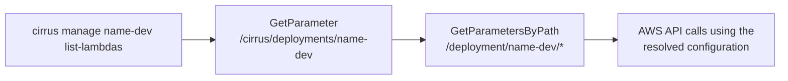

# Using the CLI

The Cirrus CLI (the `cirrus` command) is a command-line tool for operating an
existing Cirrus deployment: listing and invoking Lambda functions, submitting
and rerunning workflows, inspecting Step Functions executions, querying the
DynamoDB state database, and fetching stored payloads. It is built with
[click](https://click.palletsprojects.com/) and ships as part of the
`cirrus-geo` package.

This page covers installing the CLI, authenticating it against AWS, and how
it discovers a deployment's resources. For a tour of the commands themselves,
see [Common CLI workflows](common-workflows.md); for the full option listing
of every command, see the [CLI reference](reference.md). To deploy Cirrus
itself, see the [Quickstart](../getting-started/quickstart.md) instead — this
page assumes a deployment already exists.

## Installing

Install the CLI with [pipx](https://pipx.pypa.io/):

```bash
pipx install 'cirrus-geo[cli]'
```

The `[cli]` extra pulls in the dependencies the management commands need
(`click`, `backoff`, `click-option-group`) without requiring the rest of the
`cirrus-geo` package.

To run a single command without installing anything, use
[`uvx`](https://docs.astral.sh/uv/guides/tools/) to fetch and run the CLI in
an ephemeral environment:

```bash
uvx --from 'cirrus-geo[cli]' cirrus version
```

## Credentials

The CLI calls AWS APIs directly through `boto3`, so it needs a set of AWS
credentials before any command that touches a deployment will work. Any
credential source `boto3` understands works — a named profile, environment
variables, an instance role, and so on. `cirrus` also accepts `--profile` and
`--region` options (before the subcommand) to select a specific AWS CLI
profile or region for the session.

If your organization uses AWS IAM Identity Center (SSO), configure a profile
once with `aws configure sso`, then start each session with:

```bash
aws sso login --profile your-profile-name
```

SSO sessions expire and need to be refreshed periodically; if a command fails
with an SSO-related error, the CLI reports it directly and tells you to run
`aws sso login` again.

### Required permissions

The identity the CLI runs as needs permission to call the AWS APIs behind the
commands you use. In broad terms, that identity must be allowed to:

- Read SSM Parameter Store parameters under `/cirrus/deployments/` and
  `/deployment/<name>/` (deployment discovery — see below).
- Read and invoke Lambda functions in the deployment (`list-lambdas`,
  `invoke-lambda`).
- Send messages to the deployment's SQS process queue (`process`,
  `run-workflow`).
- Read and write objects in the deployment's payload bucket (payload
  retrieval, oversized-payload upload).
- Read and query the deployment's DynamoDB state table (`get-state`,
  `query`, `get-input-payloads`, and workflow-status polling).
- Describe Step Functions state machines and executions, and read their
  event history (`get-execution*`, `get-workflow-definition`).
- Read CloudWatch Logs (`get-lambda-logs`, `get-batch-logs`).

Which of these you actually need depends on which commands you run — a user
who only lists deployments and tails logs needs far less than one running
`run-workflow` and `migrate`. Scope credentials to the commands the identity
is expected to use rather than granting all of the above by default.

### Assuming a role: `CIRRUS_CLI_IAM_ARN`

A deployment's parameter set can include a `CIRRUS_CLI_IAM_ARN` value (or you
can pass an ARN directly with `cirrus manage <deployment> --iam-arn
<role-arn> ...`). When set, the CLI calls `sts:AssumeRole` on that ARN using
your current credentials and uses the resulting temporary credentials — under
the session name `cirrus_cli_session` — for every AWS call made against that
deployment. This lets a deployment centralize the permissions above on a
single role instead of granting them to every user's own identity directly;
your own credentials only need `sts:AssumeRole` on the target role. If both
are present, the deployment's `CIRRUS_CLI_IAM_ARN` parameter takes precedence
and the `--iam-arn` option is ignored.

## Deployment discovery

Most CLI commands operate against a specific deployment, identified by name.
Rather than requiring you to know a deployment's Lambda names, queue URLs, or
table names, the CLI looks them up from SSM Parameter Store at run time.

Each deployment publishes a pointer parameter at `/cirrus/deployments/<name>`
whose value identifies where the deployment's own configuration parameters
live — by default, under `/deployment/<name>/`. That prefix holds one
parameter per configuration value the CLI needs, including
`CIRRUS_PAYLOAD_BUCKET`, `CIRRUS_STATE_DB`, `CIRRUS_PROCESS_QUEUE_URL`,
`CIRRUS_BASE_WORKFLOW_ARN`, and `CIRRUS_PREFIX` (used to identify the
deployment's Lambda functions by name).



`cirrus list-deployments` lists every deployment name visible under
`/cirrus/deployments/` for the current credentials:

```bash
cirrus list-deployments
```

The reference CloudFormation in this repository
(`cloudformation/cli/ssm_parameters.yaml`) creates both the pointer and the
configuration parameters for a deployment automatically as part of the
regular deploy; you do not create or maintain them by hand unless you are
integrating the CLI with an unmanaged deployment.

## Running commands against a deployment

Deployment-scoped commands live under `cirrus manage <deployment-name>`.
`mgmt` is a registered alias for `manage`, and both `manage` and its
subcommands support prefix matching — any unambiguous leading substring of a
command name resolves to that command. For example, these are equivalent:

```bash
cirrus manage name-dev list-lambdas
cirrus mgmt name-dev list-lambdas
cirrus mgmt name-dev list-l
```

A minimal end-to-end example: install the CLI, authenticate, and list the
Lambda functions in a deployment.

```bash
pipx install 'cirrus-geo[cli]'
aws sso login --profile your-profile-name
cirrus mgmt name-dev list-lambdas
```

From here, [Common CLI workflows](common-workflows.md) walks through running
workflows, inspecting executions, querying the state database, and the rest
of the command set.
