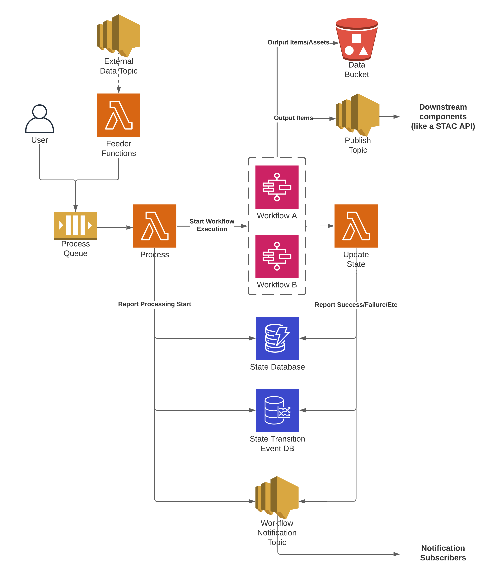
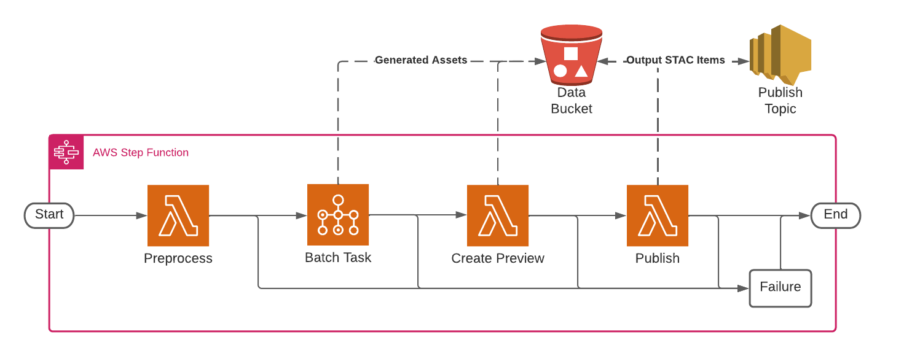

# How Cirrus works

Cirrus is a [STAC](https://stacspec.org/)-based geospatial processing pipeline
platform built on serverless AWS infrastructure. As input, Cirrus takes a
[Cirrus Payload](../reference/payload-schema.md) — a GeoJSON-like
FeatureCollection, typically holding STAC items, plus a `process` block
naming a workflow — and runs it through that workflow to produce an output
payload with zero or more STAC items. On success, Cirrus uploads the output
payload to the [payload bucket](../reference/payload-bucket.md) and
publishes each output item to an SNS topic, so a workflow's results can
trigger indexing into a STAC API (such as
[stac-server](https://github.com/stac-utils/stac-server)) or feed further
processing. Storing output items and their assets anywhere else — a data
bucket, a catalog — is the job of task code, not the framework.

The design intent is STAC in, STAC out: input items are STAC-like by
schema requirement, and workflows are meant to emit complete STAC items —
that is what the publish topic and downstream STAC tooling assume. Only the
input side is enforced, though; nothing in the framework validates what a
workflow's final task returns, so a pipeline can deviate on output (or, to a
lesser degree, input) shape where its consumers allow it.

The `cirrus` Python package (installed as the `cirrus-geo` distribution)
provides both the [Cirrus CLI](../cli/using-the-cli.md) for interacting with
a deployed Cirrus instance — running workflows, fetching payloads and logs,
querying state — and `cirrus.lib`, the library the framework's own Lambda
functions are built on. Feeder authors can reuse `cirrus.lib` for payload
handling and state queries; task authors mostly interact with
[stac-task](https://github.com/stac-utils/stac-task) instead, though
`cirrus.lib.logging` is useful for matching the framework's structured log
format.

## Components

Four kinds of pieces are involved in running a payload through Cirrus, and
they play different roles. The built-in **functions** are the pipeline
machinery Cirrus provides; **workflows** and **tasks** are the user-authored
processing that machinery runs a payload through; and **feeders** sit
upstream of the pipeline entirely — they are whatever puts payloads on the
process queue in the first place.

- **[Feeders](../building-pipelines/feeders.md)** put a Cirrus Payload on the
  process queue, triggering a workflow execution. A feeder can be anything
  that can call `sqs:SendMessage` on the process queue or publish to an SNS
  topic the queue is subscribed to — an S3 event notification, a scheduled
  search against an external API, a manual submission. Cirrus does not ship
  feeders: there is no feeder scaffolding, base class, or CloudFormation
  resource in this repository. Everything upstream of the process queue is
  each deployment's own to build.
- **[Tasks](../building-pipelines/tasks.md)** are the unit of work inside a
  workflow. A task takes a Cirrus Payload as input and returns a Cirrus
  Payload as output, doing the actual processing in between — for example,
  transforming data to data, data to metadata, or metadata to metadata. Tasks
  run on Lambda or AWS Batch and are typically written with the
  [stac-task](https://github.com/stac-utils/stac-task) library (recommended,
  not required — the contract is the payload in and out); task code lives
  outside this repository, in each deployment's own task images.
- **[Workflows](../building-pipelines/workflows.md)** are [AWS Step
  Functions](https://docs.aws.amazon.com/step-functions/latest/dg/welcome.html)
  state machines that define the sequence of tasks a payload runs through.
  The `process` Lambda function dispatches a payload to a workflow by name,
  matching a state machine named `${ResourcePrefix}-<workflow_name>` — any
  deployment mechanism that creates a state machine with that name works;
  this repository's reference CloudFormation deploys each workflow as its
  own stack. Most workflows run one or more tasks, but a workflow can have
  none — the in-repo `minimal` workflow used in the
  [Quickstart](quickstart.md) is a single `Choice` state with no tasks at
  all.
- **[Functions](../reference/lambda-functions.md)** are the five Lambda
  functions built into Cirrus itself (`process`, `update-state`, `pre-batch`,
  `post-batch`, `api`). `process` and `update-state` move payloads into and
  out of workflows and track state; `pre-batch` and `post-batch` shuttle
  payloads through S3 around a Batch task, which cannot receive a large JSON
  payload directly; `api` exposes deployment data over HTTP. All five ship
  with Cirrus rather than being authored per deployment.

This is the framework/user-code boundary: Cirrus provides the process/
update-state machinery, the state database, and the payload bucket, plus
reference CloudFormation templates for standing all of it up — a starting
point, not the required deployment mechanism; any infrastructure tooling
that creates the same resources works. Users provide the feeders that feed
it, the task code that does the processing, and the workflow definitions
that wire tasks together.

## Architecture

A feeder puts a payload on the process **SQS queue**, either directly or
through an SNS topic the queue is subscribed to. The **`process`** Lambda function
consumes the queue, creates or updates the payload's
[state database](../reference/state-database.md) record, and starts a Step
Functions execution of the workflow named in the payload's process
definition.

The workflow's tasks run, reading and returning Cirrus Payloads, uploading
any generated assets to the data bucket. When the Step Functions execution
reaches a terminal status, an EventBridge rule (matching on the
`${ResourcePrefix}-*` state machine ARN prefix) invokes the **`update-state`**
Lambda function. `update-state` records the outcome in the state database
(`SUCCEEDED`, `FAILED`, `INVALID`, or `ABORTED`), uploads the output payload
to the payload bucket on success, and:

- publishes each output item to the **publish SNS topic**, for downstream
  subscribers such as a STAC API ingest process
- enqueues any chained payloads back onto the process queue, continuing a
  [workflow chain](../building-pipelines/chaining-workflows.md)

Every state transition is also announced on a **workflow event** channel —
CloudWatch Logs metric filters by default, or optionally the deprecated
Timestream-backed event database shown as "State Transition Event DB" in the
diagram above — which the [`api`](../reference/lambda-functions.md#api)
function and [monitoring](../operating/monitoring.md) tooling read from.

A workflow itself is a sequence of tasks chained together in a Step Functions
state machine:

Each task reads the Cirrus Payload produced by the previous step, does its
work, uploads any generated assets to the data bucket, and returns an updated
payload for the next task. `pre-batch` and `post-batch` are not tasks
themselves — they are framework Lambda functions, shipped with the core
stack, that work around the fact that a Batch job submission cannot carry a
large JSON payload directly. The workflow author does have to wire them in
as states immediately before and after each Batch task — see [Wiring a Batch
task into a workflow](../building-pipelines/batch-workflow-structure.md). If any task
fails, the workflow's `Fail` state routes the execution to a failed terminal
status; if every task completes, the execution succeeds.

## Glossary

**execution**
: A single run of a workflow against one payload — one Step Functions state
machine execution.

**feeder**
: Anything that builds a Cirrus Payload and puts it on the process queue.
Not part of the Cirrus framework; see [Feeders](../building-pipelines/feeders.md).

**payload**
: The JSON document — STAC items plus a process definition — used as input
to (and returned as output from) a workflow execution. See the
[Cirrus Payload schema](../reference/payload-schema.md).

**payload bucket**
: The S3 bucket where Cirrus stores execution input/output payloads and
other payload objects too large to pass inline. See
[Payload bucket](../reference/payload-bucket.md).

**publish**
: Uploading a workflow's output STAC items and assets to S3 and publishing
the items to the Cirrus publish SNS topic, done by the `update-state`
function on a successful execution.

**state database**
: The DynamoDB table that tracks the state of every payload a Cirrus
deployment has processed — also called the StateDB. See
[State database](../reference/state-database.md).

**task**
: A single unit of processing within a workflow, run on Lambda or Batch,
taking a Cirrus Payload as input and returning one as output. See
[Tasks](../building-pipelines/tasks.md).

**workflow**
: An AWS Step Functions state machine that processes a payload. Most
workflows run one or more tasks, but a workflow can have none — the
`minimal` workflow has zero tasks. See [Workflows](../building-pipelines/workflows.md).
