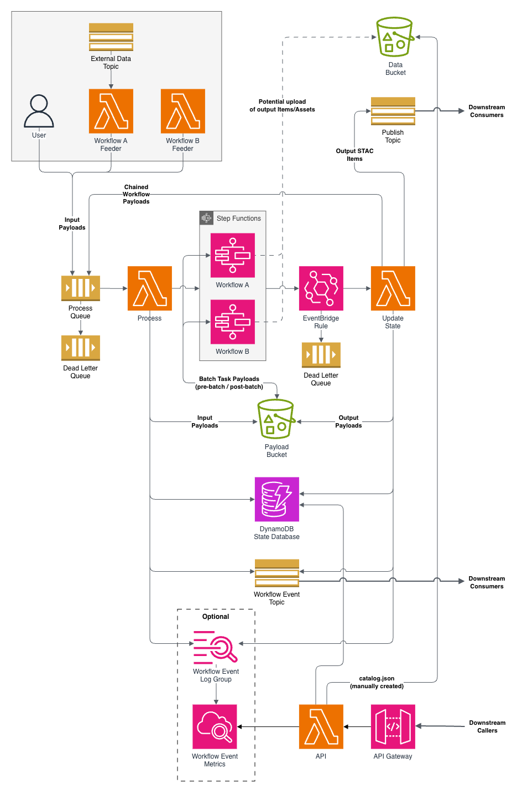

# How Cirrus works

Cirrus runs a payload through a workflow and publishes what comes out. A feeder puts a payload on a queue. Cirrus starts a Step Functions execution of the workflow the payload names, and the workflow's tasks transform the payload's items. When the execution finishes, Cirrus records the outcome, stores the output, and publishes each output item to an SNS topic for whatever comes next: a STAC API ingest, another workflow, or a subscriber of your own.

## The payload

A [Cirrus Payload](../reference/payload-schema.md) is a GeoJSON-like FeatureCollection with a `process` array. `features` holds the input items, ordinarily STAC Items. `process[0]` names the workflow and carries the parameters its tasks read. The payload's `id`, of the form `<collections>/workflow-<workflow>/<itemids>`, is the unit of work: the same items through the same workflow are the same payload, and Cirrus runs it once unless told to replace an earlier run.

The intent is STAC in, STAC out. Cirrus validates the payload's structure, not its items. Any object with an `id` is an acceptable input item, and whatever the last task returns is stored and published as is. Whether a pipeline produces STAC is up to its tasks.

## What you build and what Cirrus provides

| You write | Cirrus provides |
| --- | --- |
| **Feeders.** Code that builds payloads and sends them to the process queue. Anything with `sqs:SendMessage` on the queue qualifies. | **The process queue** and its dead-letter queue. |
| **Workflows.** Step Functions state machines, one CloudFormation stack each, named `${ResourcePrefix}-<workflow>`. | **`process`**, which consumes the queue, records the payload, and starts the execution. |
| **Tasks.** The Lambda functions and Batch jobs a workflow invokes. Each takes a payload and returns one. | **`update-state`**, which records the outcome, stores the output payload, publishes the items, and continues chains. |
| | **`pre-batch` and `post-batch`**, which move a payload into and out of a Batch job through S3. |
| | **The state database**, **the payload bucket**, **the publish and workflow-event topics**, and the read-only **`api`**. |

The CloudFormation templates in `cloudformation/` create the right-hand column. They are the reference deployment, not the only one: the functions read everything they need from environment variables, so any tooling that creates the same resources and sets the same variables works. The [Deployment contract](../reference/deployment-contract.md) lists them, and [Deploying to AWS](../operating/deploying.md) is the procedure for the templates.

## Life of a payload

1. A [feeder](../building-pipelines/feeders.md) sends the payload to the process queue.
2. [`process`](../reference/lambda-functions.md#process) takes it off the queue, validates it, claims it in the [state database](../reference/state-database.md), uploads it to the [payload bucket](../reference/payload-bucket.md), and starts an execution of the state machine named `${ResourcePrefix}-<workflow>` with the payload as input.
3. The state machine runs its [tasks](../building-pipelines/tasks.md). Each receives the payload the previous one returned. A Lambda task gets it as its event; a Batch task gets it through S3, with `pre-batch` and `post-batch` on either side. Tasks upload the assets they produce to a data bucket and point the items at them.
4. When the execution ends, EventBridge invokes [`update-state`](../reference/lambda-functions.md#update-state) with the status, input, and output. It records `SUCCEEDED`, `FAILED`, `INVALID`, or `ABORTED`. On success it also stores the output payload and publishes each output item to the publish topic. If the payload's `process` array has more entries, it builds the next payload and sends it back to the queue.

`process` and `update-state` announce each of these steps as a [workflow event](../reference/workflow-events.md), which is what dashboards and alerts consume. To watch a payload take this path with the CLI, see [Follow a payload through Cirrus](follow-a-payload.md).

## Workflows are Step Functions state machines

A [workflow](../building-pipelines/workflows.md) is an Amazon States Language definition. Cirrus asks three things of it:

- The state machine's name follows the convention above, so `process` can find it and `update-state` is told when it finishes.
- Its `Fail` state carries the failing task's error forward, so the state database records why.
- Its final output is the payload, since that is what `update-state` stores and publishes.

Which tasks run, in what order, and with what retries is the workflow author's decision.

Tasks run on Lambda or on [AWS Batch](../building-pipelines/batch-infrastructure.md). A Batch job cannot receive a payload directly, so a workflow wraps each Batch task in `pre-batch` and `post-batch` states; see [Batch tasks in a workflow](../building-pipelines/batch-workflow-structure.md).

## Where to go next

- [Quickstart](quickstart.md) runs the reference stack on LocalStack, and [Deploying to AWS](../operating/deploying.md) deploys it to an account.
- [Building pipelines](../building-pipelines/tasks.md) covers tasks, workflows, and feeders.
- [Using the CLI](../cli/using-the-cli.md) and the [Python library](../api/index.md) are the two ways to work with a deployment from outside AWS.
