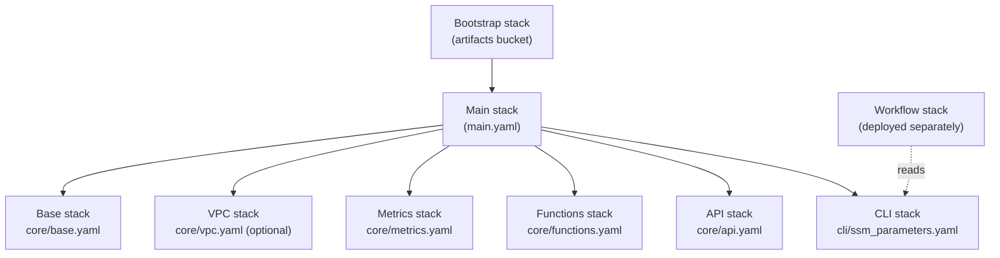

# Quickstart

This walks through deploying Cirrus infrastructure and running a minimal
test workflow through it with the Cirrus CLI, using the CloudFormation
templates in [`cloudformation/`](https://github.com/cirrus-geo/cirrus-geo/tree/main/cloudformation).
Every step below has an AWS tab and a [LocalStack](https://www.localstack.cloud/)
tab — pick AWS to deploy to a real account, or LocalStack to run the same
stacks against a local Docker container with no AWS account required.

On AWS, expect roughly 10-15 minutes wall-clock for the full deploy (bootstrap,
Lambda packaging, and three CloudFormation deploys, each of which waits on
nested-stack creation) plus a few minutes to run the test workflow. All of
the deployed resources — Lambda, SQS, DynamoDB (on-demand), S3, and a
Standard Step Functions workflow — are pay-per-use with no idle-cost
servers, so running through this guide and tearing the stacks back down
costs a small fraction of a dollar. The only component billed regardless of
traffic is the NAT gateway created when the VPC is enabled (see
[VPC considerations](../operating/deployment.md#vpc-considerations)); the
LocalStack path and the `EnableVpc=false` AWS variant below avoid it
entirely.

## Overview

The CloudFormation templates deploy Cirrus as a set of nested stacks:

- **Base infrastructure** (`core/base.yaml`): S3 data and payload buckets, the
  DynamoDB state table, SQS process/dead-letter queues, SNS publish and
  workflow-event topics.
- **VPC** (`core/vpc.yaml`, optional): VPC with public/private subnets, NAT
  gateway, and S3/DynamoDB gateway endpoints for Lambda networking.
- **Workflow metrics** (`core/metrics.yaml`): a CloudWatch log group and
  metric filters for workflow events.
- **Lambda functions** (`core/functions.yaml`): the five core functions (API,
  Process, Update State, Pre-Batch, Post-Batch) with their IAM roles.
- **API Gateway** (`core/api.yaml`): a REST API (EDGE) proxying to the API
  Lambda, with CloudWatch access logging.
- **CLI configuration** (`cli/ssm_parameters.yaml`): Parameter Store entries
  the Cirrus CLI reads to discover a deployment's resources.

A separate **bootstrap** stack (`bootstrap/bootstrap.yaml`) creates the S3
bucket used to stage packaged Lambda code and templates before the main
stack deploys. Workflows (Step Functions state machines) deploy as their own
stacks, independent of the main stack, so they can iterate without touching
core infrastructure. See [Deployment](../operating/deployment.md) for the
stack-by-stack parameter and output reference.



## Prerequisites

- AWS CLI installed and configured, with credentials that have permission to
  create the resources above (`CAPABILITY_NAMED_IAM` is required for the main
  stack deploy).
- Python 3.12+ for Lambda function packaging.
- The Cirrus CLI installed — see [Installing](../cli/using-the-cli.md#installing).
- For the LocalStack path: Docker, to run LocalStack via `compose.yml`, in
  place of AWS credentials.

## Configure deployment variables

Stack names and deployment parameters are set as shell environment variables,
sourced from an example file at the project root:

=== "AWS"

    ```bash
    cp .env.aws.example .env.aws
    # edit .env.aws as needed
    source .env.aws
    ```

    `.env.aws.example` sets:

    | Variable | Default | Purpose |
    | --- | --- | --- |
    | `BOOTSTRAP_STACK` | `cirrus-bootstrap` | Bootstrap stack name |
    | `MAIN_STACK` | `cirrus-sandbox` | Main stack name |
    | `MINIMAL_WORKFLOW_STACK` | `cirrus-sandbox-minimal-workflow` | Minimal workflow stack name |
    | `RESOURCE_PREFIX` | `cirrus-sandbox` | Prefix applied to all resource names (`ResourcePrefix` parameter) |
    | `LAMBDA_PYTHON_VERSION` | `3.13` | Lambda runtime version |
    | `LAMBDA_ARCH` | `arm64` | Lambda CPU architecture |
    | `LOG_LEVEL` | `DEBUG` | Cirrus log level |
    | `ENABLE_VPC` | `true` | Whether to create a VPC and attach Lambdas to it |
    | `VPC_CIDR` | `10.1.0.0/16` | VPC CIDR block |
    | `PRIVATE_SUBNET_CIDR` | `10.1.10.0/24` | Private subnet CIDR |
    | `PUBLIC_SUBNET_CIDR` | `10.1.1.0/24` | Public subnet CIDR |

    Set `ENABLE_VPC="false"` to skip the VPC stack and its hourly-billed NAT
    gateway — the minimal workflow below needs no VPC-only resources.

=== "LocalStack"

    ```bash
    cp .env.localstack.example .env.localstack
    # edit .env.localstack as needed
    source .env.localstack

    docker compose up -d -V
    ```

    `.env.localstack.example` sets the same stack-name and Lambda-packaging
    variables as `.env.aws.example`, plus AWS CLI environment variables
    pointed at the local LocalStack endpoint (`AWS_ENDPOINT_URL=http://localhost:4566`,
    and placeholder credentials `testing`/`testing` hard-coded to guard
    against an accidental deploy to a real AWS account). It has no VPC
    variables — the LocalStack deploy always runs with `EnableVpc=false`.

    `docker compose up -d -V` starts LocalStack from `compose.yml` at the
    project root.

## Bootstrap and deploy

### 1. Deploy the bootstrap stack

Creates the S3 bucket used to stage packaged Lambda code and templates:

=== "AWS"

    ```bash
    aws cloudformation deploy \
      --stack-name "$BOOTSTRAP_STACK" \
      --template-file cloudformation/bootstrap/bootstrap.yaml \
      --parameter-overrides \
        "ResourcePrefix=$RESOURCE_PREFIX"
    ```

    !!! note
        `aws cloudformation deploy` is a create-or-update operation: it
        modifies an existing stack if one exists, for this and every deploy
        command below.

=== "LocalStack"

    `bin/localstack-provision.bash` wraps the same bootstrap/package/deploy
    sequence for LocalStack, reading the stack names and parameters from the
    sourced `.env.localstack`:

    ```bash
    ./bin/localstack-provision.bash bootstrap
    ```

    !!! note
        LocalStack can get into a broken state after a bad CloudFormation
        apply/rollback. If a later step leaves the system unrecoverable,
        restart LocalStack with `docker compose up -d -V` and redeploy from
        this step.

### 2. Package the Lambda functions

=== "AWS"

    ```bash
    ./bin/build-lambda-dist.py \
        -p "$LAMBDA_PYTHON_VERSION" \
        -a "$LAMBDA_ARCH" \
        -o "cloudformation/core/lambda-packages/cirrus-lambda-dist.zip"
    ```

=== "LocalStack"

    `localstack-provision.bash deploy` (next step) packages the Lambda
    functions automatically before deploying — no separate packaging command
    is needed.

### 3. Package and deploy the main stack

=== "AWS"

    ```bash
    # Get the S3 bucket for packaging
    ARTIFACT_BUCKET=$(aws cloudformation describe-stacks \
      --stack-name "$BOOTSTRAP_STACK" \
      --query 'Stacks[0].Outputs[?OutputKey==`CirrusDeploymentArtifactsBucket`].OutputValue' \
      --output text)

    # Package templates and Lambda code
    aws cloudformation package \
      --template-file cloudformation/main.yaml \
      --s3-bucket "$ARTIFACT_BUCKET" \
      --output-template-file packaged-template.yaml

    # Deploy the packaged stack
    aws cloudformation deploy \
      --stack-name "$MAIN_STACK" \
      --template-file packaged-template.yaml \
      --parameter-overrides \
        "ResourcePrefix=$RESOURCE_PREFIX" \
        "LambdaPythonVersion=$LAMBDA_PYTHON_VERSION" \
        "LambdaArch=$LAMBDA_ARCH" \
        "LogLevel=$LOG_LEVEL" \
        "EnableVpc=$ENABLE_VPC" \
        "VpcCidr=$VPC_CIDR" \
        "PrivateSubnetCidr=$PRIVATE_SUBNET_CIDR" \
        "PublicSubnetCidr=$PUBLIC_SUBNET_CIDR" \
      --capabilities CAPABILITY_NAMED_IAM
    ```

=== "LocalStack"

    ```bash
    ./bin/localstack-provision.bash deploy
    ```

    `deploy` packages the Lambda functions, packages and deploys the main
    stack (with `EnableVpc=false`), and deploys the minimal workflow stack
    from [step 5](#5-deploy-the-workflow-stack) below in the same command. It
    can be run repeatedly as an idempotent way to apply stack updates.

### 4. Inspect deployed resources

=== "AWS"

    ```bash
    aws cloudformation describe-stacks --stack-name "$MAIN_STACK" \
      --query 'Stacks[0].Outputs | sort_by(@, &Description)' \
      --output table
    ```

=== "LocalStack"

    Standard AWS CLI commands work against the LocalStack endpoint once
    `.env.localstack` is sourced, for example to list S3 buckets:

    ```bash
    aws s3 ls
    ```

    The same `describe-stacks` command as the AWS tab works too, since it
    reads from the LocalStack endpoint configured by `.env.localstack`.

The main stack's outputs include the data and payload bucket names, the state
table name, the process queue URL, SNS topic ARNs, the API Gateway URL and ID,
and the CLI's deployment name and Parameter Store prefix (see `main.yaml` for
the full output list, or [Deployment](../operating/deployment.md) for the
stack-by-stack reference).

## Run the minimal test workflow

Workflows deploy as separate stacks so they can be iterated on without
touching core infrastructure. A minimal workflow is provided under
`cloudformation/workflows/minimal/` for testing a deployment end-to-end.

### 5. Deploy the workflow stack

=== "AWS"

    ```bash
    aws cloudformation deploy \
      --template-file cloudformation/workflows/minimal/state_machine.yaml \
      --stack-name "$MINIMAL_WORKFLOW_STACK" \
      --parameter-overrides \
        "ResourcePrefix=$RESOURCE_PREFIX" \
      --capabilities CAPABILITY_NAMED_IAM
    ```

=== "LocalStack"

    Already deployed as part of `./bin/localstack-provision.bash deploy` in
    [step 3](#3-package-and-deploy-the-main-stack) — no separate command
    needed.

The minimal workflow is a single Step Functions `Choice` state that checks
the `succeed` field in the first entry of the payload's `process` block: if
`true`, the execution succeeds; otherwise it fails with a
`WorkflowMismatch` error.

### 6. Submit a test payload

`cloudformation/workflows/minimal/payload.json.template` is a payload
template with `succeed`, `replace`, and `id_suffix` template variables. Render
it with `cirrus payload template` and pass it to `cirrus manage run-workflow`,
which submits the payload, polls the state database until the execution
reaches a terminal state, and prints the output payload. This command is
identical on both AWS and LocalStack — the CLI reads deployment endpoints
from the environment configured in the previous steps:

```bash
<cloudformation/workflows/minimal/payload.json.template cirrus payload template \
    | cirrus manage "$RESOURCE_PREFIX" run-workflow
```

Set `succeed` to `false` to drive a failing execution:

```bash
<cloudformation/workflows/minimal/payload.json.template cirrus payload template \
    -x succeed false \
    | cirrus manage "$RESOURCE_PREFIX" run-workflow
```

See [Run a workflow and wait for the result](../cli/common-workflows.md#run-a-workflow-and-wait-for-the-result)
in the CLI cookbook for `run-workflow`'s exit codes.

Set `replace` to `true` to allow resubmitting the same payload ID (default is
`false`), and set `id_suffix` to a unique value (default unset) to generate a
distinct payload ID per submission:

```bash
<cloudformation/workflows/minimal/payload.json.template cirrus payload template \
    -x succeed false \
    -x replace true \
    -x id_suffix "-$(uuidgen)" \
    | cirrus manage "$RESOURCE_PREFIX" run-workflow
```

### Calling the HTTP API directly (LocalStack)

On LocalStack, the API Gateway endpoint is also reachable directly with
`curl`, which is useful for exploring the API without the CLI. Get the API ID
first:

```bash
API_ID=$(aws cloudformation describe-stacks \
  --stack-name "$MAIN_STACK" \
  --query 'Stacks[0].Outputs[?OutputKey==`ApiGatewayId`].OutputValue' \
  --output text)
```

then:

```bash
curl "http://localhost:4566/restapis/${API_ID}/dev/_user_request_/<desired_path>"
```

For example, to list items in the state database for the minimal workflow:

```bash
curl "http://localhost:4566/restapis/${API_ID}/dev/_user_request_/collection/workflow-minimal/items"
```

## Stack cleanup

=== "AWS"

    S3 buckets must be emptied before their stacks can be deleted:

    ```bash
    DATA_BUCKET=$(aws cloudformation describe-stacks \
      --stack-name "$MAIN_STACK" \
      --query 'Stacks[0].Outputs[?OutputKey==`CirrusDataBucket`].OutputValue' \
      --output text)

    PAYLOAD_BUCKET=$(aws cloudformation describe-stacks \
      --stack-name "$MAIN_STACK" \
      --query 'Stacks[0].Outputs[?OutputKey==`CirrusPayloadBucket`].OutputValue' \
      --output text)

    ARTIFACT_BUCKET=$(aws cloudformation describe-stacks \
      --stack-name "$BOOTSTRAP_STACK" \
      --query 'Stacks[0].Outputs[?OutputKey==`CirrusDeploymentArtifactsBucket`].OutputValue' \
      --output text)

    aws s3 rm s3://$DATA_BUCKET --recursive
    aws s3 rm s3://$PAYLOAD_BUCKET --recursive
    aws s3 rm s3://$ARTIFACT_BUCKET --recursive
    ```

    Then delete the stacks, workflows first, then the main stack, then
    bootstrap:

    ```bash
    aws cloudformation delete-stack --stack-name "$MINIMAL_WORKFLOW_STACK"
    aws cloudformation wait stack-delete-complete --stack-name "$MINIMAL_WORKFLOW_STACK"

    aws cloudformation delete-stack --stack-name "$MAIN_STACK"
    aws cloudformation wait stack-delete-complete --stack-name "$MAIN_STACK"

    aws cloudformation delete-stack --stack-name "$BOOTSTRAP_STACK"
    aws cloudformation wait stack-delete-complete --stack-name "$BOOTSTRAP_STACK"
    ```

=== "LocalStack"

    `localstack-provision.bash` handles bucket emptying and delete ordering:

    ```bash
    ./bin/localstack-provision.bash delete
    ./bin/localstack-provision.bash debootstrap
    ```

## Next steps

- [How Cirrus works](how-cirrus-works.md) for how these pieces fit together.
- [Payloads](../reference/payload-schema.md) for the payload format the CLI and workflows
  consume.
- [CLI reference](../cli/using-the-cli.md) for the rest of the `cirrus` command
  tree.
